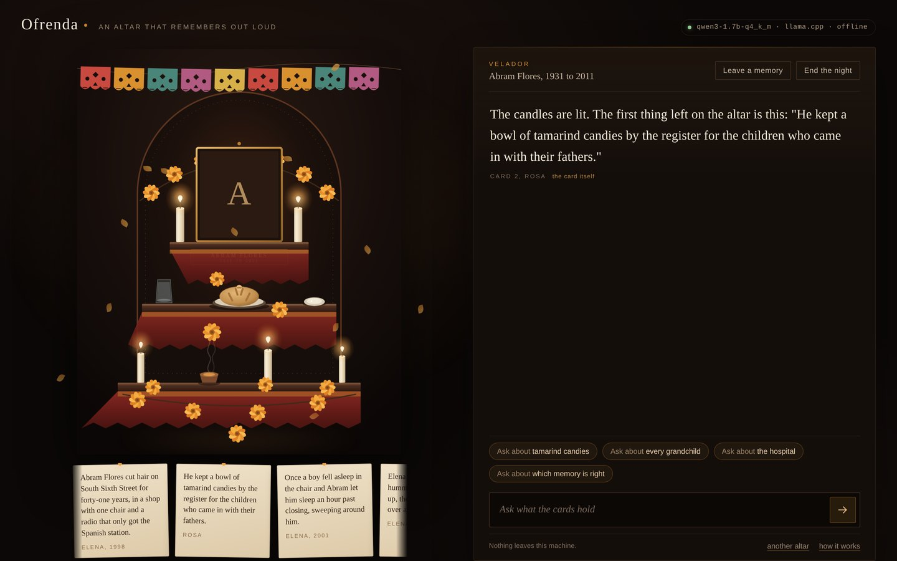
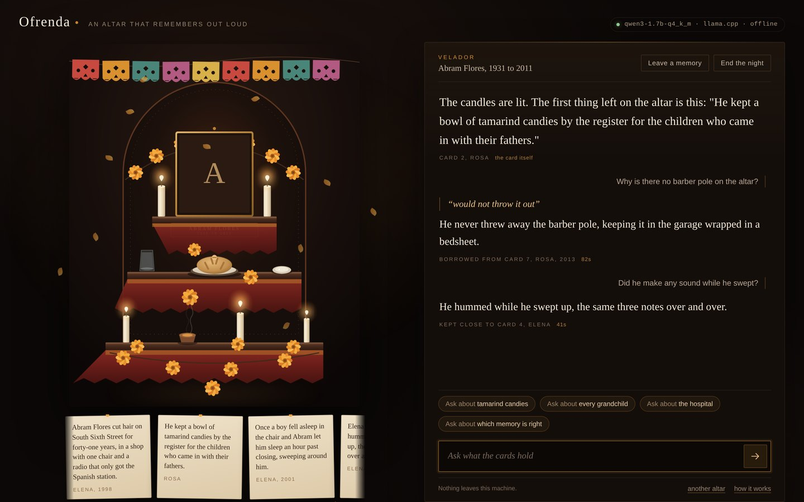
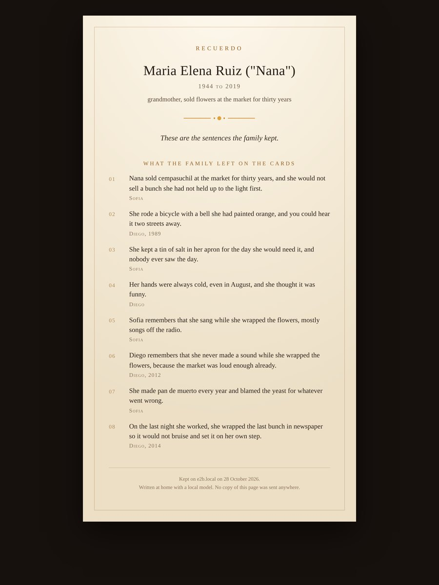

# Ofrenda

An altar that remembers out loud.

Ofrenda is a small web app and a terminal séance that turn a handful of family
memories into a conversation, using an open-weight model running on the machine
in front of you. The model is not allowed to invent. It can only hold up words
that somebody in the family wrote down, and the program checks every phrase it
claims to be quoting before it reaches the screen.

Spanish uses *ofrenda* for the offerings left on an altar on the night of the
dead; Portuguese says *oferenda*. The program is named for the offering, not for
the dead.



---

## What it does

You write cards, one memory each. Who remembered it, and the year if you know
it. Then you light the candles.

The altar answers in two parts. First it borrows a short phrase from one of the
cards, word for word. Then it says one plain sentence around that phrase. If a
question touches nothing on the cards, it says so and stops. If two people
remember the same moment differently, it names both and leaves the argument
open, which is usually the most honest thing a family can do with a memory.

At the end of the night the candles go out and the altar prints a *recuerdo*: a
printable card with the closing line and every memory in the family's own words.

Four things worth noticing while you use it:

- **Grounding is enforced in code, not in the prompt.** The harness picks the
  card, the model picks the phrase, and the phrase is checked against the card
  before anything is shown. Answers that fail are sent back once with the phrase
  fixed, and then replaced with the card read out loud.
- **Nothing leaves the machine.** There is no API key, no account, no telemetry,
  no outbound request. The model is a file; the record is a file.
- **It works with no model at all.** If llama.cpp is missing, the altar still
  runs and reads the cards verbatim. The AI is an enhancement, not a dependency.
- **The offline claim is a script, not a promise.** `scripts/prove-offline.py`
  puts the app in a network namespace with nothing but loopback, asks it five
  questions, tries to reach two APIs, and prints the result.

## Try it

You need Python 3.10 or newer. Nothing else to install for the app itself.

```bash
git clone https://github.com/YOU/ofrenda.git
cd ofrenda

scripts/fetch-runtime.sh     # prebuilt llama.cpp into ./vendor
scripts/fetch-model.sh       # Qwen3 1.7B GGUF into ./models, about 1.1 GB

python3 ofrenda.py doctor    # check runtime, model, and record
python3 ofrenda.py serve     # the altar, in a browser, on localhost
```

If you already have `llama-server` on your `PATH` and a `.gguf` file you like,
skip both scripts and point Ofrenda at them:

```bash
export OFRENDA_LLAMA_SERVER=/path/to/llama-server
export OFRENDA_MODEL=/path/to/your-model.gguf
```

Or use a server that is already running (Ollama, LM Studio, llama.cpp, vLLM):

```bash
OFRENDA_BACKEND=http://127.0.0.1:11434/v1 OFRENDA_MODEL_NAME=qwen3:1.7b python3 ofrenda.py serve
```

### The terminal instead

```bash
python3 ofrenda.py seance --sample abram
```

Same altar, same cards, same model, no browser. Type a question. `/cards` lists
the record, `/ask` suggests something to ask about, ctrl-d puts the candles out.

### Commands

| command | what it does |
| --- | --- |
| `python3 ofrenda.py serve` | the altar in a browser (localhost only by default) |
| `python3 ofrenda.py seance` | the altar in the terminal |
| `python3 ofrenda.py doctor` | checks the runtime, the model, and the record |
| `python3 ofrenda.py keepsake` | writes the recuerdo as html and text |
| `python3 ofrenda.py new --sample maria` | starts a fresh record from a sample |
| `scripts/prove-offline.py` | runs the altar with no network and writes down what happened |

## What it looks like when it works

A night with Abram's cards. The opening line is read from a card and labelled
as such; the second answer borrows its phrase from card 7 and names Rosa; the
third sits next to a card that disagrees with it, and the altar says so instead
of choosing. The seconds on the right are this project's worst case, a two core
machine with no GPU.



The page it prints when the candles go out:



## The three samples

The repository carries three finished records, so the project runs before you
have written anything of your own. They are invented people, written the way a
family writes.

- **Abram Flores**, 1931 to 2011. A barber on South Sixth Street for forty-one
  years. Two of his granddaughters remember the same sweeping differently.
- **Maria Elena Ruiz**, 1944 to 2019. Sold cempasuchil at the market for thirty
  years. Same disagreement, different sisters.
- **June Park**, 1954 to 1998. Ran a bulletin board called The Marigold off one
  phone line in the spare room. A nod to a corner of the internet that is mostly
  gone, since the model can only speak about her from what her children typed.

## Where the record lives

One file: `data/altar.json`. It holds the person, the cards, and the transcript
of every night, including what the model said and which card it borrowed from.
It is ignored by git on purpose. A photograph you put on the altar is stored in
your browser's local storage and never uploaded, because the server has no
endpoint that would accept it.

To start again, delete the file.

## How the grounding works

A 1.7B model asked to "answer warmly from these notes" will invent a morning
nobody lived and attribute it to the wrong sister. So the work is split:

1. **The harness chooses.** TF-IDF over the family's own words picks the card
   that touches the question. If no card shares a content word with the
   question, the answer is a refusal written by the harness, not by the model.
2. **The model phrases.** Given one card, it copies three to six words and
   writes one or two sentences about them.
3. **The checker decides.** The copied phrase must appear in the card exactly.
   The sentence must stay inside the card's own vocabulary, must not introduce a
   name, a number, or a person who did not write that card, and must not drift
   onto a neighbouring memory.
4. **Failure has a floor.** One retry with the phrase supplied by the harness.
   If that fails, the card is read out loud, word for word. The interface marks
   those turns as *read word for word* so nobody mistakes one for a generated
   sentence.

The rules run in `core/ground.py`. They are about 300 lines of plain Python and
you can read them on a laptop with the internet off, which is rather the point.

## What is open in here

| piece | licence | why it matters here |
| --- | --- | --- |
| Qwen3 (open weights) | Apache 2.0 | the whole voice; swappable for any GGUF |
| llama.cpp | MIT | CPU inference with no account, no key, no network |
| this repository | MIT | the guardrails are readable, forkable, and yours |

No part of the project needs a service that can be discontinued.

## Requirements

- Python 3.10 or newer, standard library only
- llama.cpp (`llama-server`), prebuilt or compiled
- a GGUF model, 0.6B to whatever your memory allows
- about 2 GB of RAM for the 1.7B model at Q4_K_M

On a modern laptop, a sentence takes two to five seconds. On a two core virtual
machine it takes eight to twenty, which is why the interface shows a candle
leaning and tells you when the wait is normal and not a crash.

## Layout

```
ofrenda.py           command line entry point
core/llm.py          llama.cpp on loopback, or any OpenAI-compatible local server
core/store.py        the record: person, cards, nights
core/retrieval.py    tf-idf, phrase picking, disagreements
core/ground.py       prompt, checker, retries, the verbatim floor
core/keepsake.py     the printable recuerdo
core/seance.py       the terminal version
core/server.py       a small http server, standard library only
web/                 the altar, drawn by hand in svg, css, and plain js
samples/             three finished records
tests/               31 tests, no model needed
```

## Tests

```bash
python3 -m unittest discover -s tests -v
```

The tests are mostly about refusal: invented numbers, invented quotations, the
wrong sister, a sentence that falls outside the card it claims to come from, and
the case where a question touches nothing and the altar is supposed to say so.

## Licence

MIT, see `LICENSE`. The sample people are inventions. Please do not use Ofrenda
to put words in a real dead person's mouth; it is built to make that difficult,
but it is a tool, not a conscience.
